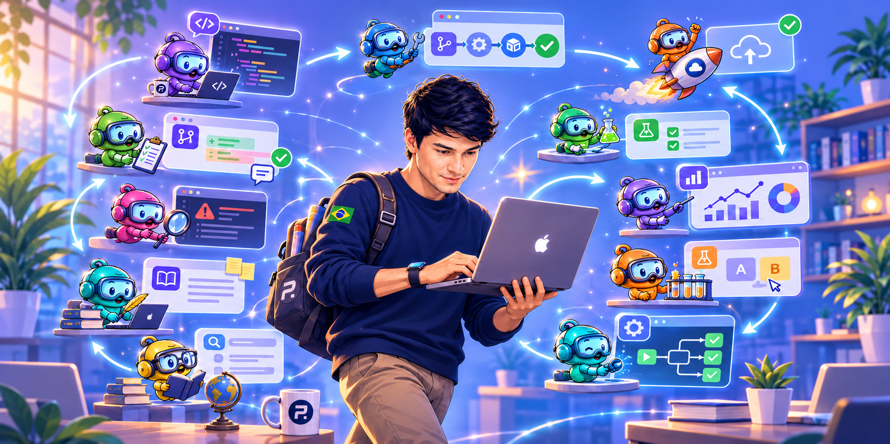
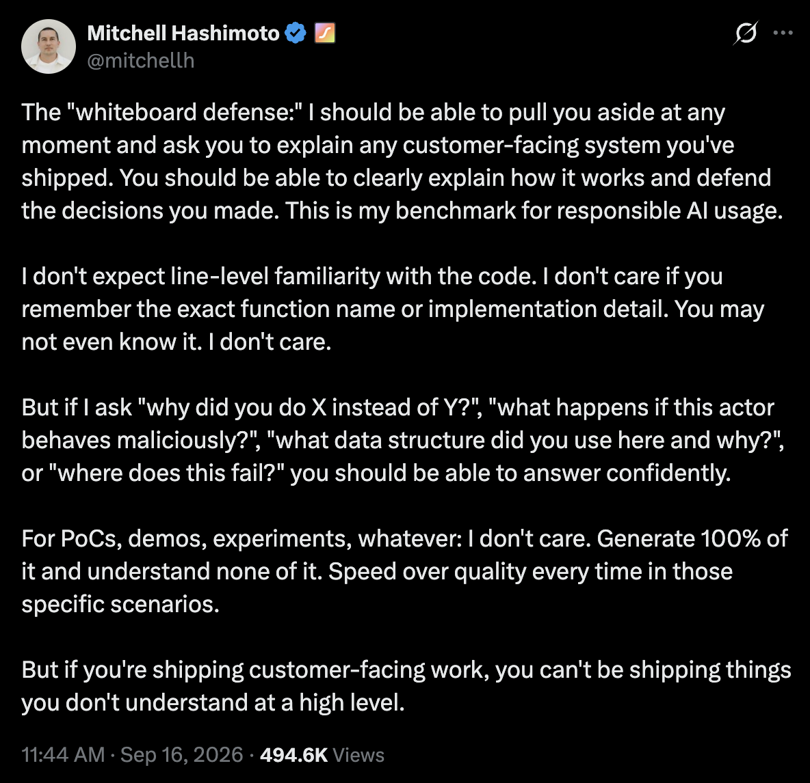

Em novembro de 2022, o [ChatGPT](https://openai.com/index/chatgpt/) chegou. IA não era novidade para muita gente do mundo de machine learning, que já trabalhava a fundo com ela havia anos. Mas, para a maioria de nós, desenvolvedores comuns, foi nossa primeira experiência real usando IA. Um verdadeiro avanço. A indústria mudou desde então.

Para engenheiros e desenvolvedores, tudo começou com pequenos passos, mas ganhou ritmo rápido. O autocomplete com IA no VS Code significava que você escrevia menos. O [Cursor](https://cursor.com/) apareceu, aplicando mudanças inteiras. Você ainda aprovava uma por uma, mas a maior parte do trabalho já era feita pela IA. Então veio o [Claude Code](https://code.claude.com/docs/en/overview), e agora você nem aprova mais cada passo. YOLO para todos. Harnesses começaram a aparecer por toda parte, novos modelos continuaram chegando, e nós continuamos mudando e aprendendo. Aprendemos sobre [Context Engineering](https://www.anthropic.com/engineering/effective-context-engineering-for-ai-agents), [Loop Engineering](https://www.ibm.com/think/topics/loop-engineering) e muito mais. Tudo em menos de quatro anos.

Nem todas as empresas estão prontas para isso ou fizeram esse esforço. Muitas ainda estão aprendendo o básico, avançando em passos controlados e sem usar todo o poder que temos. Não é fácil entender tudo isso. Depois de quase dois anos trabalhando com IA diariamente, incluindo os últimos doze meses levando meu conhecimento à fronteira na Shopify, fico feliz em compartilhar minhas ideias sobre como qualquer time também pode fazer isso.

É claro que não vai sair de graça. Você precisa equilibrar os custos de assinaturas e os investimentos em infraestrutura. Mas também não é tão caro. É viável para qualquer empresa com 5+ pessoas.

Então vamos começar, na ordem em que acho que sua empresa deveria encarar isso.

# Poder computacional e infraestrutura

O primeiro investimento, além do que você já usa para rodar seus servidores, é em mais poder computacional e infraestrutura. Não acho que você precise gastar com serviços caros como [AWS](https://aws.amazon.com/) ou [GCP](https://cloud.google.com/). Você pode usar a [Hetzner](https://www.hetzner.com/), com seus ótimos preços. Mas, se a mudança atrapalhar seu [DevOps](https://en.wikipedia.org/wiki/DevOps), não tem problema continuar com o que você já tem. Invista nisso para ter:

- CI que suporte muito, muito mais PRs.
- Harnesses com agentes rodando, revisando a qualidade do seu código, dando notas ao seu sistema, encontrando bugs e muito mais. [Pi Durable](https://earendil.com/posts/pi-durable/) é ótimo para isso.

Serviços como [CodeRabbit](https://www.coderabbit.ai/), [Code Review do Claude Code](https://code.claude.com/docs/en/code-review) e outros podem ajudar nisso. Mas, investindo um pouco na sua própria configuração, você pode ter tudo isso por um custo muito menor. Decida o que é melhor para você, mas permita que seu time entregue mais mudanças e tenha agentes controlando a aprovação delas.

Se você tem um monorepo, essa é a melhor configuração para isso. Um agente pode ficar em um só lugar e percorrer sua base de código mais rápido.

TL;DR: Consiga poder de fogo primeiro.

# Experimentação

Imagine seu enxame de agentes e cinco engenheiros passando de dois pull requests por dia para vinte cada um. São cem pull requests para revisar, e agora você tem um gargalo pior para resolver. O time do Claude compartilhou um [ótimo post sobre isso e code reviews](https://claude.com/resources/articles/code-review). Uma das coisas mais importantes é conseguir fazer merge com mais segurança.

Um sistema de experimentação, como [Flipper](https://www.flippercloud.io/) para Rails, [LaunchDarkly](https://launchdarkly.com/) ou [Unleash](https://www.getunleash.io/), permite criar funcionalidades com liberação controlada. Você pode liberá-las gradualmente e até fazer os agentes desativá-las, se esses controles estiverem expostos nas suas ferramentas internas. Isso é muito poderoso.

Durante o code review automatizado, os agentes vão usar essa proteção para dar uma nota ao seu PR. Se a mudança estiver totalmente protegida, você provavelmente vai receber um A. Com essa nota alta, o engenheiro que pediu a mudança terá permissão para fazer o merge. Assim, lidar com cem PRs não é uma tarefa impossível. PRs de alto risco ainda serão revisados por humanos, mas boa parte do trabalho será destravada.

# Documentação

É muito fácil implementar mudanças. Mais difícil é pensá-las a fundo. Os agentes podem usar ferramentas como [pi-agentic-search](https://github.com/dantetekanem/pi-agentic-search), com sparsity scans, para se orientar pela base de código, e deveriam fazer isso. Mas as decisões e o significado para o negócio se perdem. Adicionar comentários ao código não é a solução de verdade. Se estiver escrito em Rust ou outra linguagem de baixo nível, deixe o código ser código.

A melhor solução é cada projeto ter uma pasta `docs/` ou `specs/`, organizada por funcionalidades, sistemas e mais. Os agentes podem então trabalhar em uma pilha de PRs:

- O primeiro PR apresenta a especificação da mudança. Os humanos são extremamente valiosos aqui.
- Os PRs seguintes implementam a mudança, respaldados por essa especificação.

Então, sim, use também stacked PRs. PRs menores durante mudanças de alto risco permitem que você avance ainda mais rápido. Leia meu post [Code Reviews Importam Pra Caramba](https://blog.leonardopereira.com/2026/04/18/code-reviews-matter-a-freaking-lot/) para saber mais.

# Instrumentação

Debugging é coisa do passado (já estava mais do que na hora). Bugs que levavam dias, ou até semanas, para serem encontrados agora podem ser encontrados por agentes em menos de uma hora. Esse talvez seja o melhor superpoder que a IA trouxe para desenvolvedores de todas as áreas. Os programadores de jogos estão muito felizes agora.

Mas isso não vem de graça. Você não diz só "conserta isso" e espera que esteja pronto. Como aprendemos com Context Engineering, você precisa alimentar o agente com dados e conhecimento (tokens), e ele vai produzir resultados (mais tokens). Então tenha sua instrumentação pronta.

O que é instrumentação? São métricas e sinais sobre como seu sistema se comporta, que dão a você alertas melhores e a maturidade de que sua empresa precisa. E logs também! Adicione logs, mas, por favor, não use logs para acompanhar métricas. Isso é terrivelmente caro e trabalho de amador.

Se você não está usando um framework para construir seu software, deveria. Você já vai ter boa parte disso, e os agentes também podem construir em cima dessa base.

Disponibilize esses sinais para seus agentes por meio de servidores MCP ou outras integrações. Conecte seu sistema de tickets, o GitHub e mais, e você terá as ferramentas de que precisa para trabalhar da melhor forma possível. Encontrar um bug crítico vira uma questão de pedir.

Use ferramentas como [Grafana](https://grafana.com/oss/grafana/) e [Prometheus](https://prometheus.io/) aqui. Gratuitas e ótimas.

# Harness bem estruturado

[Pi](https://pi.dev/), [Claude Code](https://code.claude.com/docs/en/overview), [Codex](https://developers.openai.com/codex/), [BB](https://getbb.app/), [Amp](https://ampcode.com/) e mais. Todo o trabalho acima não vai se encaixar magicamente, e essas ferramentas não fazem milagres. Você precisa investir tempo para acertar tudo.

Defina o que seu sistema faz. Mantenha skills em espaços compartilhados na sua empresa e na sua base de código. Como vocês fazem merge de PRs? Como projetam a instrumentação? Quais são seus princípios de design e suas avaliações? Tudo deve ser fácil de compartilhar entre todos os engenheiros. É claro que cada engenheiro pode personalizar sua configuração e seu `AGENTS.md`, mas a base compartilhada deve estar disponível desde o início.

Isso pode ser tão simples quanto ter um repositório dedicado ao seu harness. Também vai economizar dinheiro: os agentes não vão precisar procurar as mesmas informações toda vez. Garanta que eles consigam acessar seu código, pesquisar na web e trabalhar dentro de limites de segurança bem definidos.

Ensine seu time também e mantenha-se atualizado. Saiba quais modelos funcionam melhor que outros. Use extensões como a minha [pi-extended-teams](https://github.com/dantetekanem/pi-extended-teams) para dividir e conquistar, ampliando o que uma tarefa consegue fazer.

# Agentes nos seus canais de comunicação

Uma das coisas mais disruptivas criadas na Shopify foi o [River](https://shopify.engineering/under-the-river), nosso agente que conhece nossa empresa e roda no Slack. Ele foi construído sobre nosso harness próprio e também usa o [Quick](https://shopify.engineering/quick) para criar protótipos rapidamente e compartilhar o trabalho internamente.

Sinceramente, toda empresa precisa de algo assim. A Anthropic oferece o [Claude Tag](https://www.anthropic.com/news/introducing-claude-tag), e você também pode construir algo que atenda às suas necessidades. Aqui, acho que uma solução existente pode entregar o que você precisa rapidamente.

Imagine o seguinte: um alerta crítico dispara. Seu sistema está sob estresse extremo, e seus clientes estão sendo afetados. É 1 da manhã, o PagerDuty te acordou, e você está longe do computador. Vai levar trinta minutos para chegar ao escritório.

Você abre o Slack no celular e marca seu agente para investigar o alerta. Então vai para lá. Quando você chega, o problema já foi depurado e talvez até esteja sob controle, se a funcionalidade estava protegida pelo seu sistema de experimentação. O agente até criou um dashboard interno, com tudo o que aconteceu muito bem organizado para você ler e entender.

Isso acontece todos os dias em empresas como a Shopify (o fluxo de trabalho, não os incidentes críticos), e resolvemos problemas em questão de minutos. Nossos lojistas não são impactados, e seus clientes também não deveriam ser.

# Faça a defesa no quadro branco

Mitchell Hashimoto compartilhou este [ótimo post sobre a "defesa no quadro branco"](https://x.com/mitchellh/status/2100249348345057389?lang=en):

Não poderia concordar mais, e seu time deveria estar em cima disso. Falei sobre uma responsabilidade parecida em [O Humano no Loop](https://blog.leonardopereira.com/2026/08/19/the-human-in-the-loop/).

Seus engenheiros não deveriam simplesmente fazer código aparecer por mágica. Eles precisam entender as especificações e o que a mudança faz: qual problema a correção do bug resolve, o design por trás dela e as decisões que levaram até ali. Engenharia não é uma profissão morta. Ela importa mais do que nunca, porque agora código é barato. Saiba o que você está fazendo, garanta que seus engenheiros também saibam e seja muito intencional.

# Seja proativo, não reativo

Não acumule dívida técnica. Use fast-follows, mas tenha agentes prontos para ir lá e fazer esse trabalho. Estou construindo o [hobkin.dev](https://hobkin.dev/) para ajudar com isso. Acompanhe o que precisa ser feito, mas não deixe para trás.

Se você vir um bug, coloque um agente para trabalhar nele. Coloque seu agente do Slack nisso. Se precisar de um dashboard, construa um e configure os alertas. Não deixe as coisas para trás. Não deixe para amanhã. Um agente pode preparar para você, no dia seguinte, um resumo de tudo o que aconteceu. Aprenda.

# Entenda o que você (engenheiro) está fazendo

Toda semana, reveja o que você fez. Entenda como seu impacto está crescendo e como sua carreira está progredindo. Como você lidou com os incidentes? Quantas coisas criou? O que está funcionando e o que não está? Você está aprendendo, melhorando e se preparando para o futuro?

Continue aprendendo. A IA veio para ficar. Conheça os modelos, leia os papers e acompanhe o que está acontecendo no mundo. Você não precisa sacrificar sua vida inteira por isso, mas seja intencional e esteja aberto a mudanças. Tudo está mudando, e você também vai mudar. Aprenda enquanto faz.

---

É claro que isso não é tudo. Mas colocar essas coisas em prática vai ajudar seu time de engenharia a trabalhar muito melhor no mundo agêntico. Gerenciar pessoas, gerenciar o tempo, tirar folgas, colocar sistemas em funcionamento e entender todas as necessidades dos seus clientes ainda leva tempo. Mas você pode se adaptar rápido.

Boa programação 10x! :)
