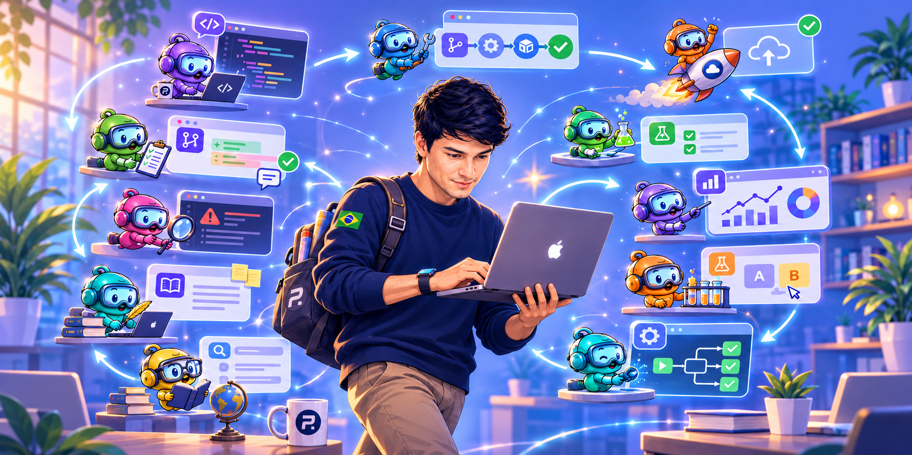
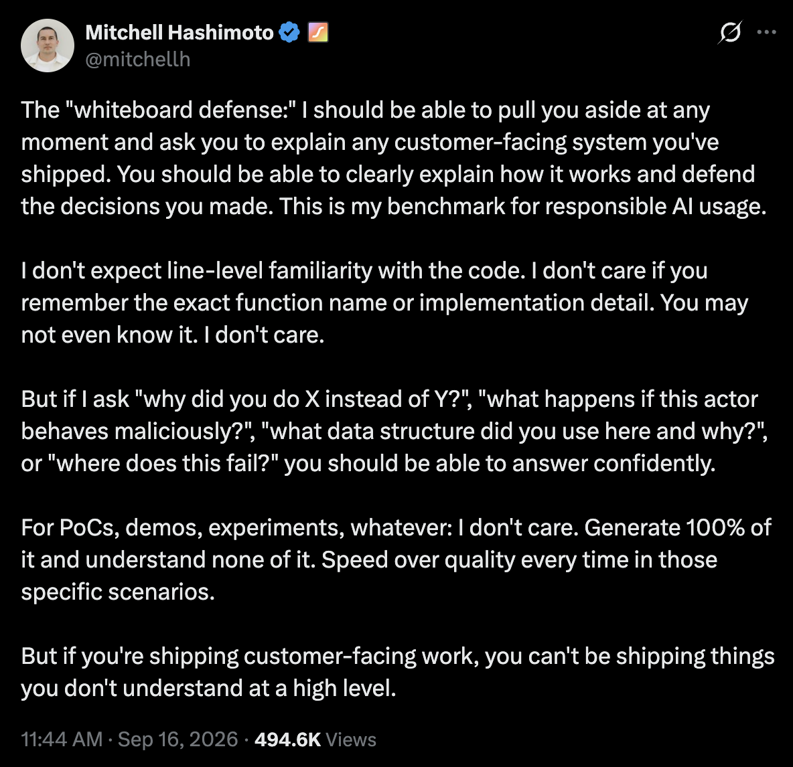

In November 2022, [ChatGPT](https://openai.com/index/chatgpt/) arrived. AI wasn't new to many people in the machine learning world, who had been working deeply with it for years. But for most of us regular developers, it was our first real experience using AI. A true breakthrough. The industry has changed since.

For engineers and developers, it started with baby steps but picked up quickly. AI autocomplete in VS Code meant you were writing less. [Cursor](https://cursor.com/) came along, patching whole changes. You would still approve them one by one, but most of the work was being done by AI. Then [Claude Code](https://code.claude.com/docs/en/overview) came, and now you're not even approving every step. YOLO for all. Harnesses started appearing everywhere, new models kept coming, and we kept changing and learning. We learned about [Context Engineering](https://www.anthropic.com/engineering/effective-context-engineering-for-ai-agents), [Loop Engineering](https://www.ibm.com/think/topics/loop-engineering), and much more. All in less than four years.

Not all companies are ready for this or have put in the effort. Many are still learning the basics, moving in controlled steps, and not using all the power we have. It's not easy to understand all of it. After almost two years of working with AI daily, including the last twelve months pushing my knowledge at the frontier at Shopify, I'm happy to share my thoughts on how any team can do this too.

It will, of course, not be free. You need to balance the costs of subscriptions and infrastructure investments. But it's not very expensive either. It's feasible for any company with 5+ people.

So let's start, in the order I think your company should approach this.

# Compute and Infrastructure

The first investment, beyond what you currently use to run your servers, is more compute and infrastructure. I don't think you need to spend this on expensive services like [AWS](https://aws.amazon.com/) or [GCP](https://cloud.google.com/). You can use [Hetzner](https://www.hetzner.com/), with its great prices. But if switching would disrupt your [DevOps](https://en.wikipedia.org/wiki/DevOps), you're fine keeping what you already have. Invest in it so you can have:

- CI that supports many, many more PRs.
- Harnesses with agents running, reviewing your code quality, grading your system, finding bugs, and more. [Pi Durable](https://earendil.com/posts/pi-durable/) is great for this.

Services like [CodeRabbit](https://www.coderabbit.ai/), [Claude Code's Code Review](https://code.claude.com/docs/en/code-review), and others can support this. But with some investment in your own setup, you can have all of it at a much lower cost. Decide what's better for you, but allow your team to push more changes and have agents gating them.

If you have a monorepo, that's the best setup for this. One agent can live in one place and work through your codebase faster.

TL;DR: Get firepower first.

# Experimentation

Imagine your swarm of agents and five engineers going from two pull requests a day to twenty each. That's one hundred pull requests to review, and now you have a worse bottleneck to deal with. The Claude team shared a [great post about this and code reviews](https://claude.com/resources/articles/code-review). One of the most important things is the ability to merge more safely.

An experimentation system, such as [Flipper](https://www.flippercloud.io/) for Rails, [LaunchDarkly](https://launchdarkly.com/), or [Unleash](https://www.getunleash.io/), lets you build gated features. You can release them gradually and even have agents deactivate them if those controls are exposed through your internal tools. This is very powerful.

During automated code review, agents will use this protection to grade your PR. If the change is fully protected, you will likely get an A. With that high score, the engineer who requested the change will be allowed to merge. With this, handling one hundred PRs is not an impossible task. High-risk PRs will still be reviewed by humans, but much of the work will be unblocked.

# Documentation

It's very easy to build changes. It's harder to think them through. Agents can use tools like [pi-agentic-search](https://github.com/dantetekanem/pi-agentic-search), with sparsity scans, to map their way through the codebase, and they should. But decisions and business meaning get lost. Adding comments to the code is not the real solution. If it's written in Rust or another low-level language, let the code be code.

The best solution is for each project to have a `docs/` or `specs/` folder, organized by features, systems, and more. Agents can then work in a stack:

- The first PR introduces the specification of the change. Humans are extremely valuable here.
- The following PRs implement the change, backed by that specification.

So yes, also use stacked PRs. Smaller PRs during high-risk changes allow you to move even faster. Read my post [Code Reviews Matter a Freaking Lot](https://blog.leonardopereira.com/2026/04/18/code-reviews-matter-a-freaking-lot/) to learn more.

# Instrumentation

Debugging is a thing of the past (about damn time). Bugs that used to take days, or even weeks, to find can now be found by agents in under an hour. This is possibly the best superpower AI has unlocked for developers across all areas. Game programmers are very happy right now.

But this doesn't come for free. You don't just say "fix it" and expect it to be done. As we've learned from Context Engineering, you need to feed the agent data and knowledge (tokens), and it will produce results (more tokens). So have your instrumentation in place.

What is instrumentation? It's metrics and signals about how your system behaves, giving you better alerts and the maturity your company needs. Also, logs! Add logs, but please don't use logs to track metrics. This is terribly expensive and amateur work.

If you're not using a framework to build your software, you should. You'll get a lot of this, and agents can build on top of it too.

Make these signals accessible to your agents through MCP servers or other integrations. Connect your ticketing system, GitHub, and more, and you'll have the tools you need to work as well as possible. Finding a critical bug becomes a matter of asking.

Use tools like [Grafana](https://grafana.com/oss/grafana/) and [Prometheus](https://prometheus.io/) here. Free and great.

# Well Structured Harness

[Pi](https://pi.dev/), [Claude Code](https://code.claude.com/docs/en/overview), [Codex](https://developers.openai.com/codex/), [BB](https://getbb.app/), [Amp](https://ampcode.com/), and more. All the work above won't come together magically, and these tools can't perform miracles. You need to invest time in getting everything right.

Define what your system does. Keep skills in shared spaces across your company and in your codebase. How do you merge PRs? How do you design instrumentation? What are your design principles and evaluations? Everything should be easy for all engineers to share. Of course, each engineer can customize their setup and `AGENTS.md`, but the shared foundation should be provided right away.

This can be as simple as having a dedicated repository for your harness. It will also save you money: agents won't need to go looking for the same information every time. Make sure they can access your code, research the web, and work within clearly defined security boundaries.

Educate your team too, and stay up to date. Know which models work better than others. Use extensions like my [pi-extended-teams](https://github.com/dantetekanem/pi-extended-teams) to divide and conquer, so you can expand what a task can do.

# Agents in your communication channels

One of the most disruptive things created at Shopify was [River](https://shopify.engineering/under-the-river), our agent that knows our company and runs in Slack. It's built on our custom harness and also uses [Quick](https://shopify.engineering/quick) to prototype quickly and share work internally.

Honestly, every company needs something like this. Anthropic offers [Claude Tag](https://www.anthropic.com/news/introducing-claude-tag), and you can also build something to fit your needs. Here, I think an existing solution can get you what you need quickly.

Imagine this: a critical alert fires. Your system is under extreme stress, and your customers are being affected. It's 1 a.m., PagerDuty woke you up, and you're far from your computer. It will take you thirty minutes to get to the office.

You open Slack on your phone and tag your agent to investigate the alert. Then you go. By the time you're back, the problem has already been debugged and might even be under control, if the feature was protected by your experimentation system. The agent has even created an internal dashboard, with everything that happened beautifully laid out for you to read and understand.

This happens every day at companies like Shopify (the workflow, not critical incidents), and we solve problems in a matter of minutes. Our merchants aren't impacted, and your customers shouldn't be either.

# Do the Whiteboard Defense

Mitchell Hashimoto shared this [great post about the "whiteboard defense"](https://x.com/mitchellh/status/2100249348345057389?lang=en):

I couldn't agree more, and your team should be on top of this. I talked about a similar responsibility in [The Human in the Loop](https://blog.leonardopereira.com/2026/08/19/the-human-in-the-loop/).

Your engineers shouldn't just magically spawn code. They need to understand the specs and what the change does: what problem the bug fix addresses, the design behind it, and the decisions that went into it. Engineering is not a dead trade. It matters more than ever, because code is now cheap. Know what you're doing, make sure your engineers do too, and be very intentional.

# Be proactive, not reactive

Don't accumulate technical debt. Use fast-follows, but have agents ready to go and get that work done. I'm building [hobkin.dev](https://hobkin.dev/) to help with this. Track what needs doing, but don't leave it behind.

If you see a bug, put an agent on it. Put your Slack agent on it. If you need a dashboard, build one and get the alerts in. Don't leave things behind. Don't leave them for tomorrow. An agent can build you a brief the next day with everything that happened. Learn.

# Understand what you (engineer) is doing

Every week, review what you've done. Understand how your impact is growing and how your career is progressing. How did you handle incidents? How many things did you create? What's working, and what isn't? Are you learning, getting better, and preparing yourself for the future?

Keep learning. AI is here to stay. Learn the models, read the papers, and follow what's happening in the world. You don't need to sacrifice your whole life to this, but be intentional and open to change. Everything is changing, and you will too. Learn while you're doing it.

---

Of course, this isn't everything. But getting these things in place will help your engineering team work much better in the agentic world. Managing people, managing time, taking time off, getting systems in place, and understanding all your customers' needs still take time. But you can adapt fast.

Happy 10x coding! :)
